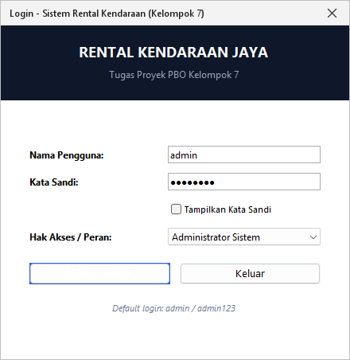
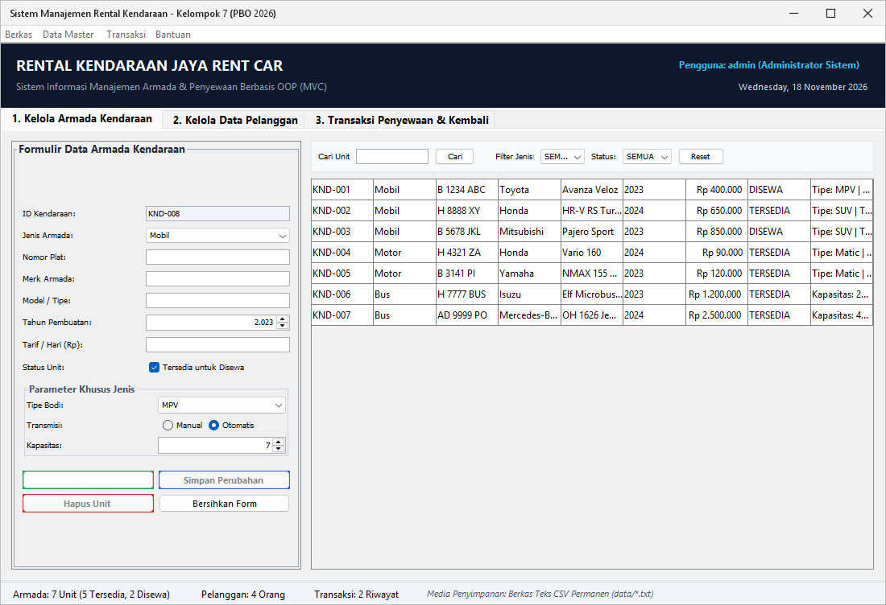
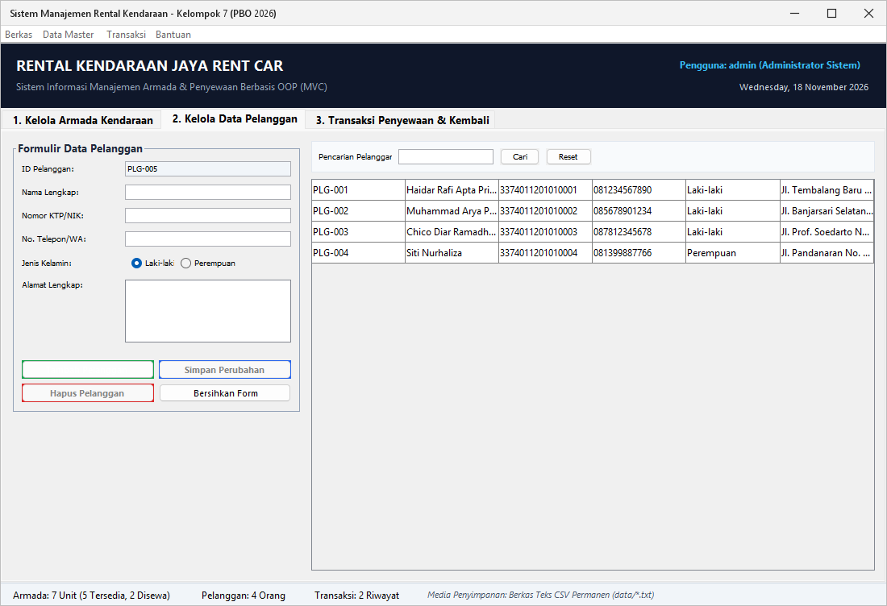
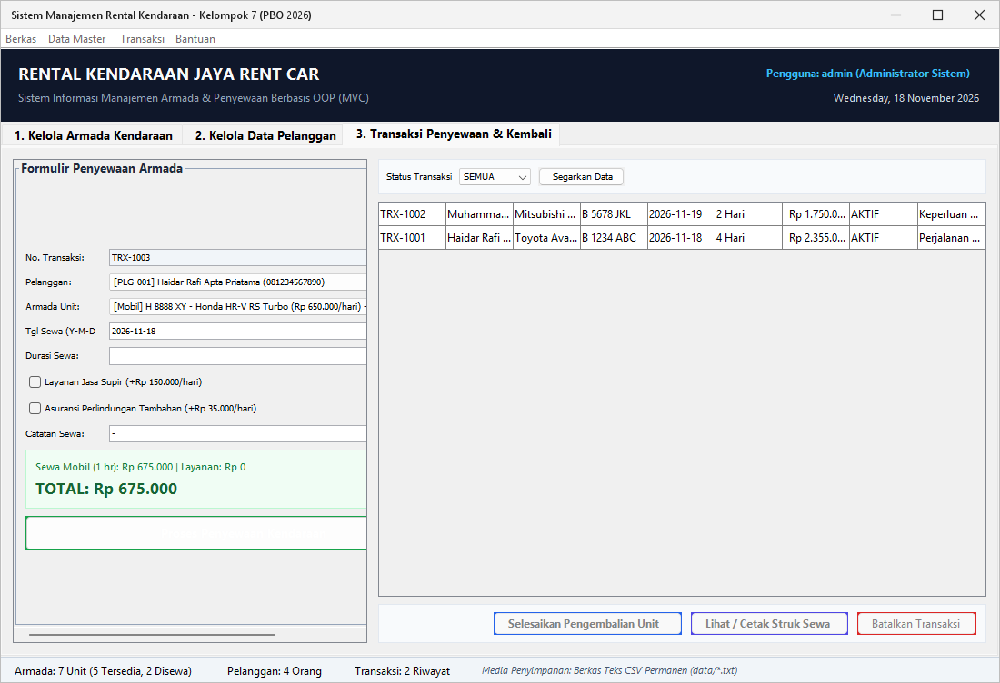
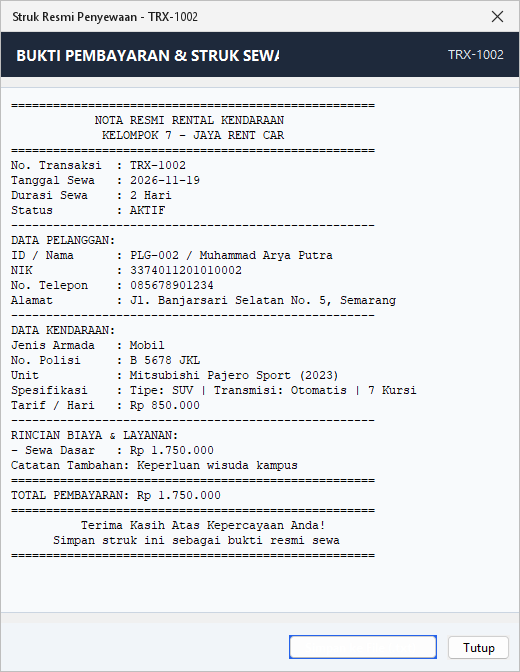
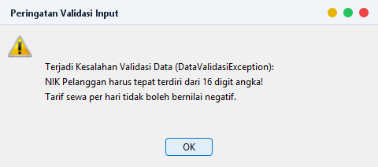

# Proyek PBO: Sistem Rental Kendaraan (Jaya Rent Car)
**Kelompok 7 - Kelas PBO B (2026)**  
**Departemen Teknik Komputer - Fakultas Teknik, Universitas Diponegoro**

---

## Anggota Kelompok 7
1. **Kevin Nibras Kusuma** (NIM: 21120124140131)
2. **Hanif Arifandi Zulfikar** (NIM: 21120124140154)
3. **Haidar Rafi Apta Priatama** (NIM: 21120124140107)

---

## Deskripsi Singkat Sistem
Aplikasi desktop berbasis Java Swing ini dirancang untuk memproses kegiatan operasional persewaan kendaraan multijenis (Mobil, Motor, dan Bus Pariwisata) secara efisien. Sistem menerapkan arsitektur **Model-View-Controller (MVC)** dan seluruh pilar Pemrograman Berorientasi Objek (Enkapsulasi, Pewarisan, Abstraksi, Polimorfisme dinamis & statis, Collection & Generics, serta Exception Handling dan Persistensi Berkas CSV).

---

## Struktur Proyek & Paket Program
```text
RentalKendaraan_Kelompok7/
├── .classpath                                # Konfigurasi classpath Eclipse IDE
├── .gitignore                                # Mengabaikan folder bin dan temporary files
├── .project                                  # Konfigurasi proyek Eclipse IDE
├── README.md                                 # Dokumentasi proyek
├── data/                                     # Penyimpanan berkas data permanen (CSV)
│   ├── kendaraan.txt
│   ├── pelanggan.txt
│   └── transaksi.txt
├── docs/                                     # Dokumen laporan proyek dan panduan tugas
│   ├── Laporan_Tugas_Proyek_PBO_Rental_Kendaraan_Kelompok_7.docx
│   └── Tugas_Proyek_PBO_GUI_2026.docx
├── screenshots/                              # Tangkapan layar antarmuka aplikasi (Windows)
│   ├── 01_login_frame.png
│   ├── 02_manajemen_kendaraan.png
│   ├── 03_manajemen_pelanggan.png
│   ├── 04_transaksi_sewa.png
│   ├── 05_dialog_struk.png
│   └── 06_dialog_validasi_error.png
└── src/
    └── rentalkendaraan/
        ├── Main.java                         # Titik masuk utama aplikasi (Entry Point)
        ├── exception/                        # Lapisan Custom Exception Handling
        │   ├── DataValidasiException.java    # Validasi masukan gagal (NIK, tarif, dsb)
        │   ├── KendaraanTidakTersediaException.java # Unit sedang disewa
        │   └── RentalException.java          # Superclass checked exception kustom
        ├── model/                            # Lapisan Model & Bisnis (OOP Pilar)
        │   ├── Bus.java                      # Subclass Kendaraan (kapasitas besar, supir wajib)
        │   ├── Diskonable.java               # Interface potongan harga sewa
        │   ├── Kendaraan.java                # Abstract class induk seluruh armada
        │   ├── LayananTambahan.java          # Interface biaya layanan supir & asuransi
        │   ├── Mobil.java                    # Subclass Kendaraan (asuransi & diskon bertingkat)
        │   ├── Motor.java                    # Subclass Kendaraan (promo gratis sewa 1 hari)
        │   ├── Pelanggan.java                # Entitas pelanggan & validasi regex NIK 16 digit
        │   └── TransaksiSewa.java            # Entitas transaksi sewa, kalkulasi polimorfis, struk
        ├── service/                          # Lapisan Controller & Persistence
        │   ├── FileStorageService.java       # Persistensi data CSV dengan try-with-resources
        │   └── RentalManager.java            # Controller pusat, CRUD, Generics (List & Map), Stream API
        └── view/                             # Lapisan Antarmuka Grafis (Java Swing)
            ├── DialogStrukSewa.java          # Dialog modal cetak/simpan struk nota (.txt)
            ├── LoginFrame.java               # Form autentikasi login (Admin & Operator)
            ├── MainDashboardFrame.java       # Window utama dengan JMenuBar & JTabbedPane
            ├── PanelKendaraan.java           # Panel CRUD armada (CardLayout dinamis)
            ├── PanelPelanggan.java           # Panel CRUD penyewa (Radio button gender, alamat)
            └── PanelTransaksi.java           # Panel transaksi sewa & pengembalian unit
```

---

## Tangkapan Layar Aplikasi
| Login Form | Manajemen Kendaraan |
|---|---|
|  |  |

| Manajemen Pelanggan | Transaksi Sewa |
|---|---|
|  |  |

| Bukti Struk Pembayaran | Validasi Exception |
|---|---|
|  |  |

---

## Cara Menjalankan Aplikasi

### 1. Menjalankan via Terminal / Command Prompt:
```bash
# Masuk ke direktori repositori
cd RentalKendaraan_Kelompok7

# Kompilasi seluruh kode program
javac -encoding UTF-8 -d bin -sourcepath src src/rentalkendaraan/Main.java

# Jalankan program
java -cp bin rentalkendaraan.Main
```

### 2. Membuka di Eclipse IDE:
1. Buka Eclipse IDE.
2. Pilih menu **File > Open Projects from File System...**
3. Klik tombol **Directory...** dan pilih folder repositori ini.
4. Klik **Finish**. Eclipse akan otomatis membaca konfigurasi `.project` dan `.classpath`.
5. Klik kanan pada `src/rentalkendaraan/Main.java` > **Run As > Java Application**.

### 3. Akun Login Bawaan:
* **Administrator**:
  * Username: `admin`
  * Password: `admin123`
* **Operator Rental**:
  * Username: `operator`
  * Password: `12345`
